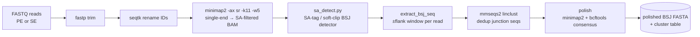

# bsj_finder

**Snakemake pipeline for rapid, annotation-free back-splice junction (BSJ) discovery from RNA-seq.**

`bsj_finder` detects circular RNAs (circRNAs) by finding the chimeric "back-splice" signature
directly in short-read alignments — **without a gene annotation and without requiring a canonical
GT/AG splice motif**. It aligns reads with `minimap2`, reads each read's supplementary-alignment
(`SA:Z`) tag to reconstruct back-splices, then extracts, deduplicates, and polishes the junction
sequences. On a synthetic benchmark it leads CIRI2 and CIRCexplorer2 on recall and F1 (see
[Benchmark](#benchmark)).

---

## Contents

- [Why bsj_finder](#why-bsj_finder)
- [How it works](#how-it-works)
- [Pipeline stages](#pipeline-stages)
- [Installation](#installation)
- [Quick start](#quick-start)
- [Inputs](#inputs)
- [Outputs](#outputs)
- [Configuration reference](#configuration-reference)
- [Benchmark](#benchmark)
- [Repository layout](#repository-layout)
- [Tuning & caveats](#tuning--caveats)
- [License](#license)

---

## Why bsj_finder

Most circRNA callers lean on an annotation (to know where exons are) and/or on the canonical
GT/AG splice motif. That misses real biology:

- **Intronic circRNAs (ciRNAs)** and other non-canonical back-splices often lack GT/AG.
- **Unannotated or novel** circles are invisible to annotation-guided tools.

`bsj_finder` is **motif-free and annotation-free**. It looks only at the alignment geometry of a
read that crosses a back-splice — a downstream donor joined to an upstream acceptor — using the
same chimeric signal (`SA:Z` supplementary alignments) that BWA-MEM-based tools read, but while
keeping `minimap2` as the aligner (fast, and long-read capable).

Highlights:

- **Annotation-free, motif-free** BSJ detection.
- **`minimap2` + `SA:Z` chimeric parsing** — recovers ~3× more junction arms than a PAF/split-read
  approach on this data.
- **Microhomology-aware breakpoints** — overlap between the two arms is trimmed so breakpoints are
  reported exactly, not shifted.
- **End-to-end**: trim → align → detect → extract junction sequences → dedup → polish.
- **Snakemake** with per-rule conda environments; scales from a laptop to HPC.
- Handles **paired-end and single-end** libraries automatically.

---

## How it works

Every read is aligned **single-end** with `minimap2 -ax sr` (R1, R2 and orphan reads are
concatenated and treated independently, so each read is evaluated on its own for the chimeric
signature). A read that spans a back-splice aligns as a **primary** segment plus a **supplementary**
segment recorded in its `SA:Z` tag. `sa_detect.py` pairs the two arms and keeps the pair when it
shows the **out-of-order ("chiastic") back-splice geometry** — the arm that comes *first in the
read* maps *downstream* in the genome of the arm that comes second — subject to per-arm anchor,
mapping-quality, and read-space gap/overlap filters.



A key detail: when the two arms overlap by `ovl` bases in the read (microhomology), those bases are
aligned by *both* arms and the exact breakpoint is ambiguous over that window. `minimap2` assigns
the overlap to the downstream arm, so `sa_detect.py` trims it from the downstream breakpoint
(`right -= ovl`) to keep the reported coordinate exact.

---

## Pipeline stages

Per sample, the DAG is:

| # | Rule | Env | Tool(s) | Output |
|---|------|-----|---------|--------|
| 1 | `trimnami_fastp` | `trimnami.yaml` | `fastp` | `trim_results/{s}_R1_trim.fastq.gz` (+ R2, + `_RS` orphans) |
| 2 | `rename_read_ids` | `seqtk.yaml` | `seqtk rename` | `trim_results/{s}_*_trim_rename.fastq.gz` |
| 3 | `minimap2_alig` | `minimap2.yaml` | `minimap2 -ax sr -k11 -w5`, `samtools view -d SA` | `align_results/{s}.bam` |
| 4 | `detect_bsj_cor` | `minimap2.yaml` | `samtools view`, `sa_detect.py` | `bsj_results/{s}.bsj_cor.tsv.gz` |
| 5 | `bsj_cor_fasta` | `biopython.yaml` | `extract_bsj_seq.py` | `bsj_results/{s}_bsj_sequences.fasta.gz` |
| 6 | `mmseqs2_dedup` | `mmseqs2.yaml` | `mmseqs2 linclust` | `dedup_results/{s}.bsj_dedup.fasta`, `{s}.bsj_cluster.tsv.gz` |
| 7 | `polished_bsj_seq` | `polished.yaml` | `minimap2`, `samtools`, `bcftools` | `polished_results/{s}.polished.fasta` (+ `.fai`) |

Stage notes:

1. **Trim** — `fastp` with quality/length filtering (`--qualified_quality_phred 15
   --length_required 90`), tail quality trimming, poly-X trimming, PE adapter auto-detection, and
   duplicate removal (`--dedup --dup_calc_accuracy 4`). SE and PE are detected automatically; unpaired
   mates from PE trimming are kept as `_RS` orphans.
2. **Rename** — read IDs are made deterministic (`{sample}.1./.2./.S.`) so downstream steps and read
   pairing are stable.
3. **Align** — all trimmed reads are concatenated and aligned **single-end** in SAM mode so that the
   `SA:Z` supplementary tags needed for detection are emitted, then encoded to **BAM** on the fly and
   filtered to SA-bearing records with `samtools view -d SA`. Dense seeding (`-k 11 -w 5`) surfaces
   short back-splice arms. The BAM is left **unsorted** — detection is a single streaming pass, so a
   coordinate sort would be wasted work; sort and index it yourself if you want to browse the
   junction arms in IGV.

   > **The alignment BAM is a junction-read BAM, not the whole library.** A read that maps
   > end-to-end at one locus has no supplementary alignment and hence no `SA:Z` tag, so `-d SA`
   > discards it — on real RNA-seq that is >99% of records. This keeps `align_results/` small and
   > means `sa_detect.py` parses ~1% as many lines in Python, but **mapping rate, `samtools
   > flagstat` and linear/host-gene coverage cannot be computed from it**. Drop `-d SA` from
   > `minimap2_alig.smk` if you need those. Supplementary records are kept (they *are* the second
   > junction arm); detection output is unaffected either way.
4. **Detect** — `samtools view` streams the BAM back out as SAM text and `sa_detect.py` parses it,
   emitting one row **per supporting read** in the `bsj_cor` schema (see [Outputs](#outputs)).
   `sa_detect.py` itself is dependency-free (Python stdlib) and reads SAM on stdin, so it shares the
   aligner's conda env purely for `samtools`. It reconstructs *both* junction arms from the primary
   line's `SA:Z` string, never reading the supplementary's own record — which is why the upstream
   `-d SA` filter is lossless for detection.
5. **Extract** — for each supporting read, a sequence window spanning the junction (±`bsj_flank` bp)
   is written to a per-read FASTA (`extract_bsj_seq.py`, using helpers in `paf_parser.py`).
6. **Dedup** — `mmseqs2 linclust` collapses near-identical junction sequences
   (`--min-seq-id 0.95 -c 0.70`), producing representative sequences plus a cluster membership table.
   Empty / single-sequence inputs are handled gracefully.
7. **Polish** — trimmed reads are aligned back to the deduplicated junction sequences and a
   `bcftools` consensus (`mpileup | call -mv → norm → filter → consensus`) yields error-corrected
   final BSJ sequences.

---

## Installation

`bsj_finder` is a Snakemake workflow. The recommended path uses **per-rule conda environments**, so
you only need Snakemake + conda/mamba installed; each rule builds its own environment on first run.

```bash
# 1. clone (with the benchmark submodule if you want the test dataset)
git clone --recurse-submodules https://github.com/roachlab/bsj_finder.git
cd bsj_finder

# 2. create a runner environment (example)
mamba create -n bsj_finder -c conda-forge -c bioconda snakemake mamba
conda activate bsj_finder
```

Then run with `--use-conda` (below) and Snakemake will provision each rule's tools.

**Tools used across the rules** (provisioned automatically with `--use-conda`, or install yourself
to run without conda): `fastp`, `seqtk`, `minimap2` (2.31), `samtools` (≥1.17), `mmseqs2` (≥14.7),
`bcftools` (≥1.17), plus Python with `biopython` and `pandas`. `sa_detect.py` itself needs only the
Python standard library.

> Running **without** conda: install the tools above onto your `PATH` and drop `--use-conda`
> (or pass `SMK_ARGS=""` if you use the benchmark's `run_bsj_finder.sh`).

---

## Quick start

Point the pipeline at a genome and a directory of FASTQs, then run to the default targets:

```bash
snakemake \
    --cores 8 --use-conda \
    --config \
        genome=/path/to/genome.fa \
        readDirectory=/path/to/reads_dir \
        outdir=results
```

- Samples are discovered automatically from `readDirectory` (via `metasnek`; PE mates are paired on
  the `_R1`/`_R2` tag).
- The default `rule all` produces, per sample: the **polished BSJ FASTA** (+ `.fai`) and the
  **dedup cluster table**.

Run a subset or a single stage by naming the target file, e.g. detection only:

```bash
snakemake --cores 4 --use-conda \
    --config genome=... readDirectory=... outdir=results \
    -- results/bsj_results/SAMPLE.bsj_cor.tsv.gz
```

Standard Snakemake flags apply (`-n` dry-run, `-p` print shell commands, `--rerun-incomplete`,
cluster/profile execution, etc.).

---

## Inputs

| Input | How to provide | Notes |
|-------|----------------|-------|
| **Reference genome** | `--config genome=...` | FASTA, optionally gzipped. |
| **Reads** | `--config readDirectory=...` | Directory of FASTQ(.gz). PE and SE both supported; PE mates paired on `_R1`/`_R2`. |
| **Output dir** | `--config outdir=...` | Defaults to `results/`. |

> The bundled `config/config.yaml` points `genome`/`readDirectory` at a local `test/` folder, which
> is **git-ignored** (not shipped). For ready-to-run example data and a full benchmark harness, use
> the **[`BSJ_test_dataset`](https://github.com/roachlab/BSJ_test_dataset)** submodule.

---

## Outputs

Under `<outdir>/`:

```
trim_results/     {s}_{R1,R2,RS}_trim[_rename].fastq.gz   trimmed + ID-renamed reads
align_results/    {s}.bam                                  chimeric (SA:Z) reads only, unsorted BAM
bsj_results/      {s}.bsj_cor.tsv.gz                       per-read BSJ calls  (see schema below)
                  {s}_bsj_sequences.fasta.gz               per-read junction-spanning sequences
dedup_results/    {s}.bsj_dedup.fasta                      representative (deduplicated) BSJ seqs
                  {s}.bsj_cluster.tsv.gz                   cluster membership (query → representative)
polished_results/ {s}.polished.fasta (+ .fai)             final error-corrected BSJ sequences
logs/             per-rule logs
```

**`bsj_cor.tsv` schema** (one row per supporting read; 0-based coordinates):

| column | meaning |
|--------|---------|
| `q_id` | read ID |
| `bsj_coord` | read-space position of the junction (used to window the read in the extract step) |
| `chromosome` | contig |
| `s_start` | circle start (min genomic breakpoint, 0-based) |
| `s_end` | circle end (max genomic breakpoint) |
| `s_strand` | strand |
| `overlap_trimmed_nt` | microhomology overlap trimmed from the downstream breakpoint |

To aggregate per-read rows into **junction-level calls** (clustering breakpoints and summing read
support), see `benchmark/bsj_finder_to_bed.py` in the `BSJ_test_dataset` submodule.

---

## Configuration reference

Set via `config/config.yaml` or `--config key=value`.

**Core**

| Key | Default | Meaning |
|-----|---------|---------|
| `genome` | — | Reference FASTA (.gz ok). |
| `readDirectory` | — | Directory of input FASTQs. |
| `outdir` | `results` | Output directory. |

**SA-tag detector (`sa_detect.py`)**

| Key | Default | Meaning |
|-----|---------|---------|
| `minimap2_k` | `11` | minimap2 `-k` (seed length). Set to `21` (the `sr` preset default) for multi-Gb genomes. |
| `minimap2_w` | `5` | minimap2 `-w` (minimizer window). Set to `11` for multi-Gb genomes. |
| `min_align_len` | `12` | Minimum aligned bp per arm (the SA detector's per-arm **anchor**). |
| `min_mapq` | `1` | Minimum MAPQ per arm (short split arms map at low MAPQ). |
| `sa_max_read_gap` | `20` | Max unaligned gap between the two arms in read space (bp). |
| `sa_max_read_ovlp` | `20` | Max arm overlap / microhomology (bp). |
| `max_gap_size` | `100000` | Max genomic span of a circle. |
| `bsj_flank` | `50` | Bases each side of the junction extracted per read. |

**Deduplication (`mmseqs2`)**

| Key | Default | Meaning |
|-----|---------|---------|
| `mmseqs_min_seq_id` | `0.95` | Cluster identity threshold. |
| `mmseqs_min_cov` | `0.70` | Coverage threshold. |
| `mmseqs_cov_mode` | `0` | Coverage mode (0 = query+target). |

**Polishing (`samtools`/`bcftools`)**

| Key | Default | Meaning |
|-----|---------|---------|
| `polish_min_mapq` | `20` | `samtools view -q` for polish alignments. |
| `polish_min_match` | `75` | `samtools view -m` minimum matched bases. |
| `bcftools_min_qual` | `20` | Variant `QUAL` filter. |
| `bcftools_min_dp` | `3` | Variant `DP` filter. |
| `sort_mem` | `1G` | `samtools sort -m`. |

> **Legacy keys** — `min_align_frac`, `max_bsj_gap`, `max_bsj_ovlp`, `min_pident`,
> `valid_coord_dist` belong to the previous PAF-based detector and are **not used** by the current
> `sa_detect.py` path. They remain in `config.yaml` for reference. (`min_align_len` and `min_mapq`
> *are* still used, as noted above.)

---

## Benchmark

`bsj_finder` is benchmarked against **CIRI2** and **CIRCexplorer2** on a synthetic dataset (a
~1.5 Mbp toy genome, 48 truth back-splice junctions across categories A–M plus 39 decoys, 8 library
types = {PE, SE} × {150, 100} bp × {low, high error}). Harness and data live in the
[`BSJ_test_dataset`](https://github.com/roachlab/BSJ_test_dataset) submodule.

Mean over the 8 libraries (48-junction truth):

| tool | recall | precision | F1 | specificity |
|------|--------|-----------|----|-------------|
| **bsj_finder** | **0.96** | 0.90 | **0.92** | 1.00 |
| CIRCexplorer2 (de-novo) | 0.77 | 0.89 | 0.81 | 0.99 |
| CIRI2 | 0.71 | 1.00 | 0.83 | 1.00 |
| CIRCexplorer2 (known) | 0.62 | 1.00 | 0.76 | 1.00 |

`bsj_finder` leads on **recall** and **F1**. It is uniquely strong on **intronic ciRNA** and other
non-canonical categories where motif-dependent callers score zero. Precision depends on how tightly
per-read breakpoints are consolidated into junctions: the false positives are breakpoint-wobble
"satellites" of true junctions on error-prone reads, so the benchmark's junction converter merges
breakpoints within a tolerance (`merge-tol`, default 12 bp), which raises precision from ~0.78 to
~0.90 at essentially no cost to recall.

---

## Repository layout

```
bsj_finder/
├── Snakefile                     # entry point; sample discovery + rule all
├── config/
│   └── config.yaml               # all tunable parameters
├── workflow/
│   ├── rules/
│   │   ├── trimnami_trim.smk     # fastp trim + seqtk rename
│   │   ├── minimap2_alig.smk     # single-end alignment → SA-filtered BAM
│   │   ├── detect_bsj_cor.smk    # streams the BAM through sa_detect.py
│   │   ├── extract_bsj_seq.smk   # per-read junction sequence extraction
│   │   ├── mmseqs2_dedup.smk     # sequence deduplication
│   │   └── polished_bsj_seq.smk  # consensus polishing
│   ├── scripts/
│   │   ├── sa_detect.py          # SA-tag / soft-clip BSJ detector (current)
│   │   ├── extract_bsj_seq.py    # extraction driver
│   │   ├── paf_parser.py         # sequence-extraction helpers (still used) + legacy PAF detector
│   │   └── detect_bsj_cor.py     # legacy PAF detector (superseded by sa_detect.py)
│   └── env/                      # per-rule conda environments
└── BSJ_test_dataset/             # git submodule: synthetic dataset + benchmark harness
```

**On the legacy files:** the detection path was migrated from a PAF/split-read approach to the
`SA:Z` chimeric detector. `detect_bsj_cor.py` (the old detector) is superseded by `sa_detect.py`.
`paf_parser.py` is **not** dead code, however — it still provides `load_bsj_coordinates` and
`extract_bsj_sequences`, which the sequence-extraction step imports.

---

## Tuning & caveats

- **Real-genome tuning.** Dense seeding (`-k 11 -w 5`) and a low per-arm anchor (`min_align_len 12`)
  maximize sensitivity on the small benchmark genome, but on human-scale, repetitive sequence they
  cost runtime/memory and can admit spurious short-arm calls. Seeding is configurable via
  `minimap2_k` / `minimap2_w`; for a multi-Gb reference use the `sr` preset values (`21` / `11`),
  raise `min_align_len` (e.g. to `20`), and raise `max_gap_size` above the longest plausible circle
  span (`100000` silently drops circles from long host genes — human genes routinely exceed it).
- **Read type.** `-ax sr` is an Illumina short-read preset. For long reads (ONT/PacBio) switch to a
  `map-ont`-style preset and re-validate the SA/geometry logic.
- **Precision vs. recall.** The detector is deliberately permissive (motif-free, low anchor) to
  maximize recall; consolidate breakpoints (and/or apply a minimum read-support floor) downstream to
  trade some recall back for precision as your application requires.
- **Polishing.** The polish step currently aligns *all* trimmed reads (not only BSJ-supporting reads)
  to the deduplicated junction sequences.

---

## License

MIT — see [`LICENSE`](LICENSE).
